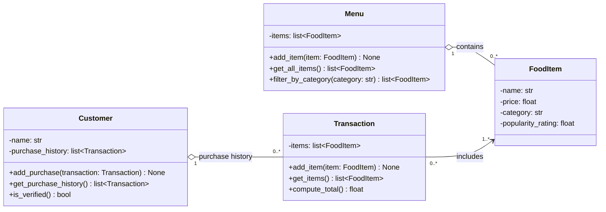

# ByteBites Class Diagram (Revised)

## Relationships

| Relationship | Multiplicity | Meaning |
|---|---|---|
| Customer → Transaction | 1 to 0..* | A customer's purchase history is a list of their past transactions. A new customer has none. |
| Menu → FoodItem | 1 to 0..* | The menu holds every food item for sale and can filter them by category. |
| Transaction → FoodItem | 0..* to 1..* | A transaction groups one or more selected items. The same item can appear in many transactions. |

## How the design covers the spec

- **Purchase history:** `Customer.purchase_history` stores past `Transaction` objects. `is_verified()` uses that history to tell whether the customer is a real user.
- **Food item details:** `FoodItem` stores `name`, `price`, `category`, and `popularity_rating`.
- **Category filtering:** `Menu.filter_by_category("Drinks")` returns only the items in that category.
- **Transaction total:** `Transaction.compute_total()` adds up the prices of its selected items.

## Assumptions

1. **Verified customer.** A customer counts as a real user if they have at least one past transaction. This is a simple check on purchase history, not login or authentication, which the reference file rules out.
2. **Simple attribute types.** `category` is a plain `str` and `popularity_rating` is a `float` (for example 4.5). The spec doesn't give a fixed category list or a rating scale.
3. **Quantities are repeated entries.** Two sodas means the same `FoodItem` appears twice in `Transaction.items`. This avoids adding a line-item class.
4. **The total is calculated, not stored.** `compute_total()` works it out from the items each time, so it can't get out of date.
5. **FoodItem has no methods.** It only holds data, so its attributes are read directly. Python doesn't need getter methods for that.
6. **One-way links.** A customer knows their transactions, but a transaction doesn't point back to its customer. The spec doesn't need the reverse link.
7. **Left out on purpose:** tax, payment, timestamps, IDs, stock levels, and storage. None of these are in the spec.
